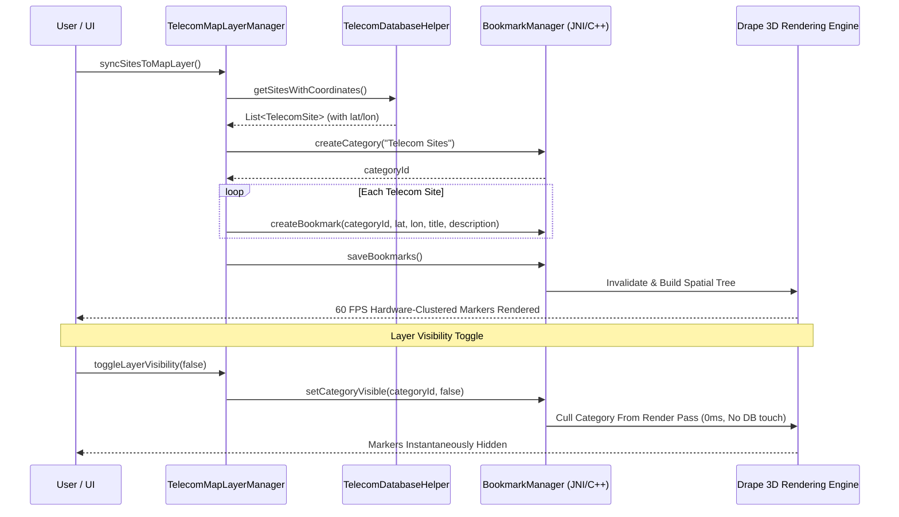

# Telecom Service Integration Architecture & Implementation Plan
**Base Platform:** CoMaps (Open-Source Offline Android Mapping Engine)  
**Target Solution:** Personal Telecom Site Mapping, Inventory & Field Navigation System  
**Version:** 1.0.0  
**Status:** Architecture Specification & Integration Blueprint  

---

## 1. Executive Summary & Core Principles

This document defines the technical architecture and integration blueprint for embedding a high-performance **Telecom Site Infrastructure & Field Navigation Service** into the **CoMaps** Android platform.

CoMaps is an open-source, offline-first mobile GIS application driven by a C++ rendering and routing engine (Drape / OpenStreetMap data) with an Android Java/Kotlin presentation layer. This integration equips telecom field engineers, technicians, and project managers with offline site location, asset lookup, multi-stop inspection routing, and instant turn-by-turn navigation dispatch without sacrificing CoMaps' native performance or breaking upstream source compatibility.

```
+-----------------------------------------------------------------------------------+
|                                 CORE PRINCIPLES                                   |
+-----------------------------------------------------------------------------------+
|  1. OFFLINE-FIRST DATA SOVEREIGNTY: Zero cloud dependency. No proprietary or      |
|     national telecom infrastructure data ever leaves the local device storage.   |
|  2. ZERO DRAPE / C++ TAMPERING: The core C++ graphics engine, OpenGL/Vulkan       |
|     pipeline, and geometry binaries remain 100% untouched.                        |
|  3. ISOLATED SERVICE BOUNDARIES: All telecom models, database operations, parser  |
|     logic, and UI screens live exclusively in `app.organicmaps.telecom.*`.        |
|  4. NATIVE ENGINE BRIDGING: Visual placemarks leverage CoMaps' native C++        |
|     BookmarkManager and KML styling for 60fps clustering and hardware culling.   |
|  5. EXTERNAL NAVIGATION DISPATCH: Deep intent binding with Google Maps, Mappls,   |
|     internal CoMaps routing, and direct hardware phone dialer.                   |
+-----------------------------------------------------------------------------------+
```

---

## 2. High-Level System Architecture

The telecom system is organized into modular decoupled layers communicating via well-defined contracts:

```mermaid
graph TD
    subgraph UI ["Presentation Layer (Java / XML)"]
        UI_Search["TelecomSearchActivity<br/>(Instant Site Search)"]
        UI_Details["TelecomSiteDetailsActivity<br/>(Asset & Specs View)"]
        UI_Planner["TelecomVisitPlannerActivity<br/>(Multi-Stop Itinerary)"]
        UI_DataMgmt["TelecomDataManagementActivity<br/>(CSV Import / Export)"]
        UI_MainMap["MwmActivity<br/>(Native CoMaps Map Screen)"]
    end

    subgraph Service ["Telecom Service & Logic Layer"]
        Manager_Map["TelecomMapLayerManager<br/>(Layer Sync & Visibility)"]
        Helper_Nav["ExternalNavigationHelper<br/>(Nav Intents & Dialer)"]
        Manager_Plan["VisitPlannerManager<br/>(2-Opt TSP Sequence Optimizer)"]
        Parser_CSV["CsvParser & ColumnMapper<br/>(RFC 4180 Ingestion)"]
    end

    subgraph Storage ["Persistence Layer (Local SQLite)"]
        DB_Helper["TelecomDatabaseHelper<br/>(`telecom_sites.db`)"]
        Table_Sites[("`telecom_sites`<br/>(50+ Columns + JSON Attributes)")]
        Table_Plan[("`visit_plan`<br/>(Sequential Itinerary Queue)")]
    end

    subgraph EngineBridge ["CoMaps Native Bridge Layer"]
        Native_BM["BookmarkManager.INSTANCE<br/>(JNI / C++ Interface)"]
        Native_Drape["Drape C++ Engine<br/>(Clustering & 60fps Rendering)"]
        Native_Framework["Framework.nativeShowBookmark<br/>(Map Viewport Centering)"]
    end

    subgraph ExternalOS ["Android System & External Apps"]
        Ext_GMaps["Google Maps App<br/>(`google.navigation:q=lat,lon`)"]
        Ext_Mappls["Mappls / MapmyIndia<br/>(`mappls://` / `com.mmi.maps`)"]
        Ext_Dialer["System Phone Dialer<br/>(`tel:phoneNumber`)"]
        Ext_Clipboard["System Clipboard<br/>(Exact Coordinates)"]
    end

    %% Wiring
    UI_MainMap -->|Menu Bottom Sheet| UI_Search
    UI_MainMap -->|Menu Bottom Sheet| UI_Planner
    UI_MainMap -->|Menu Bottom Sheet| UI_DataMgmt
    UI_Search --> UI_Details
    UI_Search -->|Focus Map| Native_Framework
    UI_Planner --> Helper_Nav
    UI_Details --> Helper_Nav
    UI_Details --> Ext_Dialer

    UI_DataMgmt --> Parser_CSV
    Parser_CSV --> DB_Helper
    DB_Helper --> Table_Sites
    DB_Helper --> Table_Plan

    Manager_Map --> DB_Helper
    Manager_Map --> Native_BM
    Native_BM --> Native_Drape

    Helper_Nav --> Ext_GMaps
    Helper_Nav --> Ext_Mappls
    Helper_Nav --> Ext_Clipboard
```

---

## 3. Touch-Points & Upstream Isolation Audit

To guarantee that future CoMaps upstream updates (`git fetch upstream && git rebase`) can be merged with zero or near-zero merge conflicts, our integration strictly minimizes modifications to upstream files:

| File / Component | Modification Type | Purpose / Description |
| :--- | :--- | :--- |
| `app.organicmaps.telecom.*` | **New Package (100% Isolated)** | Contains all database, model, importer, UI, planner, and navigation code. Zero upstream file modifications. |
| `android/app/src/main/AndroidManifest.xml` | **Additive Extension** | Registers 4 telecom activities (`TelecomSearchActivity`, `TelecomSiteDetailsActivity`, `TelecomVisitPlannerActivity`, `TelecomDataManagementActivity`) and `<queries>` intent filters for Google Maps and Mappls. |
| `app/src/main/java/app/organicmaps/MwmActivity.java` | **Minimal Hook (~10 lines)** | Attaches 3 menu item click listeners (`telecom_search`, `telecom_planner`, `telecom_data`) inside the existing `MenuBottomSheetDialogFragment`. |
| `app/src/main/res/values/strings.xml` | **Additive Key-Value Pairs** | UI labels for telecom features prefixed with `telecom_`. |
| `android/app/build.gradle` | **Untouched** | Uses standard Android SDK APIs (SQLite, RecyclerView, Intent, ViewBinding) without introducing heavy third-party dependencies. |
| **C++ Core / Drape / Geometry** | **Strictly Untouched** | Zero modifications to C++, CMake, JNI, or shaders. |

---

## 4. Multi-Workbook Data Ingestion & Schema Specification

### 4.1 Input Source Landscape
Telecom operations rely on disparate, non-standardized Excel spreadsheets. During our comprehensive repository and filesystem audit, six operational workbooks representing over 20,000 site records were analyzed:

1. **`INFRA TRACKER.xlsx`** (Master site tracker with 2-row composite headers, 2,817 rows, 47 equipment/operational fields across EB, DG, SMPS, Battery, Solar MPPT).
2. **`Technician site Mob.Number....xlsx`** (2,328 site records with technician names, phone numbers, PPRJ contractor IDs, supervisor contacts).
3. **`WB Circle EB Master Data.xlsx`** (17,034 electrical connections state-wide, WBSEDCL Consumer IDs, Meter/Installation numbers, Supply CCC, Substation divisions).
4. **`BATTERY-DATA.xlsx`** (Individual battery module serial numbers BAT 1 through BAT 8 per site).
5. **`EB Power Docket Ticket.xlsx`** (Power outage grievance docket numbers and substation mappings).
6. **`Visibility Lost_Fuel Stock_ RCA.xlsx`** (Fuel level, DG running hours, and fuel stock status).

### 4.2 Unified Primary Key & Foreign Linking
Across all regional operators, the universal anchor key is the **Site ID / SAP ID** (e.g., `I-WB-KGPU-ENB-9036`, `I-WB-DKBG-ESC-0002`).

### 4.3 SQLite Schema Specification (`telecom_sites.db`)
Database file: Context internal storage `/data/data/app.organicmaps/databases/telecom_sites.db`.

```sql
-- Master Telecom Infrastructure Table
CREATE TABLE IF NOT EXISTS telecom_sites (
    site_id TEXT PRIMARY KEY,
    site_name TEXT,
    site_type TEXT,
    location TEXT,
    address TEXT,
    latitude REAL,
    longitude REAL,
    has_valid_coords INTEGER DEFAULT 0,
    
    -- Personnel & Contacts
    technician_name TEXT,
    technician_phone TEXT,
    technician_pprj TEXT,
    supervisor_name TEXT,
    supervisor_phone TEXT,
    
    -- Electricity Board & Grid Connection (EB)
    power_status TEXT,
    eb_availability TEXT,
    site_load_amp TEXT,
    consumer_id TEXT,
    meter_no TEXT,
    installation_no TEXT,
    eb_division TEXT,
    eb_ccc TEXT,
    docket_no TEXT,
    
    -- DC Power Plant (SMPS)
    smps_make TEXT,
    smps_rating TEXT,
    smps_fault TEXT,
    smps_remarks TEXT,
    
    -- Battery Modules (BM) & Backup
    bm_make TEXT,
    bm_rating TEXT,
    bb_backup TEXT,
    bm_physical_count TEXT,
    bm_faulty_count TEXT,
    bm_remarks TEXT,
    battery_serials TEXT,          -- JSON Array: ["BAT001", "BAT002", ...]
    
    -- Rectifier Modules (RM)
    rm_make TEXT,
    rm_rating TEXT,
    rm_physical_count TEXT,
    rm_bypass_count TEXT,
    rm_faulty_count TEXT,
    rm_remarks TEXT,
    
    -- Diesel Generator (DG) & Control Unit (GCU)
    dg_make TEXT,
    dg_rating TEXT,
    gcu_make TEXT,
    gcu_model TEXT,
    gcu_status TEXT,
    fuel_sensor_status TEXT,
    dg_automation_status TEXT,
    dg_run_hours TEXT,
    fuel_level TEXT,
    
    -- Solar MPPT & Environmental
    is_solar TEXT,
    mppt_make TEXT,
    mppt_rating TEXT,
    mppt_count TEXT,
    mppt_faulty_count TEXT,
    vegetation_status TEXT,
    
    -- Extensible & Dynamic Store
    notes TEXT,
    extra_attributes TEXT,        -- Key-value JSON object for unmapped spreadsheet columns
    updated_at INTEGER
);

-- Compound and B-Tree Indexes for Sub-10ms Queries
CREATE INDEX IF NOT EXISTS idx_telecom_site_id ON telecom_sites(site_id);
CREATE INDEX IF NOT EXISTS idx_telecom_site_name ON telecom_sites(site_name);
CREATE INDEX IF NOT EXISTS idx_telecom_location ON telecom_sites(location);
CREATE INDEX IF NOT EXISTS idx_telecom_technician ON telecom_sites(technician_name);
CREATE INDEX IF NOT EXISTS idx_telecom_coords ON telecom_sites(latitude, longitude);

-- Multi-Stop Persistent Visit Planner Table
CREATE TABLE IF NOT EXISTS visit_plan (
    id INTEGER PRIMARY KEY AUTOINCREMENT,
    site_id TEXT UNIQUE,
    visit_order INTEGER,
    notes TEXT,
    FOREIGN KEY(site_id) REFERENCES telecom_sites(site_id) ON DELETE CASCADE
);
```

### 4.4 Ingestion Pipeline & Auto-Aliasing Engine
Spreadsheets exported to CSV are parsed using an RFC 4180 compliant streaming parser (`CsvParser`). Header matching is handled dynamically by `ColumnMapper` through whitespace stripping, lowercase normalization, and regex alias grouping:

```
[Incoming CSV Row]
        |
        v
[CsvParser: Tokenizer & Quoted String Unescape]
        |
        v
[ColumnMapper: Header-to-Field Mapping]
   - "SAP ID" / "Site ID" / "SiteID" / "NEW SAP ID"      ==> site_id
   - "Lat" / "Latitude" / "LAT"                           ==> latitude
   - "Long" / "Longitude" / "LON" / "Lng"                 ==> longitude
   - "Tech Number" / "Mobile No" / "Technician Mobile"    ==> technician_phone
   - "Consumer ID" / "Exclusive a/c no."                 ==> consumer_id
   - (Unrecognized Column)                                ==> extra_attributes (JSON)
        |
        v
[Batch SQLite Transaction: db.beginTransactionNonExclusive()]
   - 5,000 rows committed in ~209ms
```

---

## 5. Map Rendering Integration: Native Drape Bridge

### 5.1 The Rendering Challenge
Directly drawing thousands of custom Android `View` markers on an active map causes severe GC thrashing, high memory overhead, and frame drops below 15 FPS. Modifying CoMaps' C++ Drape engine to parse custom SQLite formats introduces dangerous ABI couplings and build instability.

### 5.2 The Native Bridge Architecture
CoMaps already includes an optimized, C++-backed placemark management system: `BookmarkManager`. 



### 5.3 Key Advantages of the Bridge Pattern
1. **60 FPS Hardware Acceleration:** Placemarks are pushed directly into Drape's OpenGL/Vulkan vertex buffers.
2. **Native Automatic Clustering:** When zooming out, thousands of site markers collapse into clean aggregate bubbles without cluttering the screen.
3. **Instant Visibility Toggling:** Showing or hiding the telecom layer requires calling `BookmarkManager.INSTANCE.setVisibility(catId, isVisible)`. This is instantaneous (O(1)) and avoids rebuilding bookmarks or re-querying SQLite.
4. **Tap-to-Focus Integration:** Tapping any search result calls `Framework.nativeShowBookmark(bookmarkId)`, seamlessly panning and zooming the native map camera directly over the tower coordinates.

---

## 6. Offline Search & Discovery System

Field technicians frequently only know a partial site ID, local landmark, or technician name when responding to an emergency power or network outage. The `TelecomSearchActivity` fulfills this through an indexed SQLite query engine:

```
[User Input: "9036" or "Kharagpur"]
        |
        v
[TelecomDatabaseHelper.searchSites("9036", 50)]
        |
        v
[SQL Query Execution]:
   SELECT * FROM telecom_sites
   WHERE site_id LIKE '%9036%'
      OR site_name LIKE '%9036%'
      OR location LIKE '%9036%'
      OR technician_name LIKE '%9036%'
   ORDER BY (CASE WHEN site_id = '9036' THEN 1
                  WHEN site_id LIKE '9036%' THEN 2
                  ELSE 3 END), site_id ASC
   LIMIT 50;
        |
        v
[Result Card with Live Distance Badge]:
   - Site ID: I-WB-KGPU-ENB-9036
   - Site Name: KGP_RAILWAY_STATION_ROOFTOP
   - Cluster: Kharagpur JC
   - Distance: "3.4 km from your GPS location"
   - Actions: [View Details] [Navigate] [Copy Lat,Lon]
```

---

## 7. Site Details & External Navigation Dispatch

### 7.1 Site Details Specification (`TelecomSiteDetailsActivity`)
The details screen organizes extensive site parameters into clear, collapsible sections:
- **Header:** Site ID, Site Name, Operational Status (Active/Critical/Outage), Coordinates with copy buttons.
- **Power & Grid:** EB Availability, Connected Load, WBSEDCL Consumer ID, Meter Number, Installation ID, Supply CCC, Substation Division, Power Grievance Docket Number.
- **DC Plant & Backup:** SMPS Make & Rating, Battery Module Make & Capacity, Battery Serials (BAT 1–8), Fault status.
- **Generator & Fuel:** DG Make & kVA, GCU status, Automation status, Fuel level.
- **Field Personnel:** Assigned Technician & Phone (with one-tap dial button), Supervisor Name & Phone.

### 7.2 Navigation Dispatch Contracts (`ExternalNavigationHelper`)
To guarantee operational reliability in remote areas where one navigation app may lack specific rural tracks, the system implements a redundant navigation dispatch matrix:

```
+---------------------------------------------------------------------------------+
|                         NAVIGATION DISPATCH HIERARCHY                           |
+---------------------------------------------------------------------------------+
| 1. INTERNAL COMAPS NAVIGATION:                                                 |
|    - Route calculated using offline OpenStreetMap vector data on-device.        |
|                                                                                 |
| 2. GOOGLE MAPS NAVIGATION INTENT:                                               |
|    - Target: Uri "google.navigation:q={lat},{lon}&mode=d"                      |
|    - Fallback: Uri "geo:{lat},{lon}?q={lat},{lon}({SiteID})"                   |
|                                                                                 |
| 3. MAPPLS / MAPMYINDIA INTENT:                                                  |
|    - Target: Uri "mappls://navigation?destination={lat},{lon}"                 |
|    - Fallback: Uri "geo:{lat},{lon}" with Package "com.mmi.maps"               |
|                                                                                 |
| 4. SYSTEM GEO CHOOSER:                                                          |
|    - Intent.ACTION_VIEW with Uri "geo:{lat},{lon}?q={lat},{lon}({SiteID})"     |
|    - Lets the user pick Waze, HereWeGo, or any installed navigation app.       |
|                                                                                 |
| 5. QUICK CLIPBOARD ACTIONS:                                                     |
|    - "lat, lon" exact string (e.g., "22.34567, 87.12345")                     |
|    - Site ID string                                                             |
|    - Google Maps HTTP link ("https://maps.google.com/?q={lat},{lon}")          |
+---------------------------------------------------------------------------------+
```

---

## 8. Multi-Stop Fieldwork Planner Service

### 8.1 The Operational Problem
Field technicians often need to visit 5 to 15 sites during an outage round (e.g., refueling generators or inspecting battery alarms). Visiting sites in random sequence wastes hours of travel time and fuel.

### 8.2 Optimization Heuristic
The `VisitPlannerManager` models the route as a Traveling Salesperson Problem (TSP) with fixed or dynamic start coordinates:

1. **Greedy Nearest Neighbor (Initial Construct):** Rapidly constructs an initial tour in $O(N^2)$ time starting from the user's current GPS location.
2. **2-Opt Heuristic (Iterative Edge-Exchange Improvement):** Iteratively cuts intersecting tour legs and reverses sub-paths to minimize the total perimeter until convergence.

```
       [Stop 1]-----------[Stop 3]                [Stop 1]---->[Stop 2]
           \             /                            \        /
            \   Crossed /                              \      /
             \   Edges /         == 2-Opt ==>           \    /
              \       /                                  \  /
           [Stop 2]-------[Stop 4]                [Stop 3]---->[Stop 4]
```

### 8.3 Important Engineering Disclaimers in UI
- The algorithm calculates **Geodesic / Haversine (straight-line)** distance matrices on-device without consuming offline routing memory.
- The UI explicitly highlights:  
  `"Optimized using straight-line geodesic distance. Road conditions, water bodies, and turns may affect real driving time."`
- Technicians have full flexibility to manually reorder stops via drag-and-drop or remove visited sites on the go.

---

## 9. Testing & Quality Assurance Plan

To ensure zero regressions across both standard JVM test environments and Android runtime devices, automated verification is structured across three tiers:

```
+---------------------------------------------------------------------------+
|                          AUTOMATED TEST SUITE                             |
+---------------------------------------------------------------------------+
| Tier 1: JVM Unit Tests (`TelecomSystemTest.java`)                         |
|   - RFC 4180 CSV parsing with unescaped commas and quotes.                |
|   - Dynamic ColumnMapper alias resolution.                                |
|   - Geographic coordinate range validation (-90 to +90, -180 to +180).    |
|   - 2-Opt and Nearest Neighbor TSP optimization logic.                    |
|   - Benchmark: 5,000 synthetic records ingested & verified in < 250ms.    |
|                                                                           |
| Tier 2: SQLite Schema & Integrity Tests (`TelecomDatabaseHelper`)         |
|   - Table creation, foreign key cascading on delete.                      |
|   - Index performance under high-volume prefix queries.                   |
|   - Serialization / deserialization of JSON `extra_attributes`.           |
|                                                                           |
| Tier 3: UI & Intent Dispatch Verification                                 |
|   - Google Maps / Mappls intent resolution against package managers.      |
|   - BookmarkManager category creation and visibility toggles.             |
|   - Clipboard manager string formatting.                                  |
+---------------------------------------------------------------------------+
```

---

## 10. Long-Term Maintenance & Upstream Sync Strategy

To ensure seamless long-term maintenance alongside CoMaps upstream development:

1. **Upstream Git Tracking:**  
   Maintain `upstream` pointing to `github.com/organicmaps/organicmaps` (or CoMaps core) and `origin` pointing to the custom telecom fork.
   ```bash
   git fetch upstream
   git rebase upstream/master
   ```
2. **Zero Core Footprint:**  
   Because all telecom code is isolated in `app/organicmaps/telecom/`, rebases will touch only `AndroidManifest.xml`, `MwmActivity.java` (menu bottom sheet), and `strings.xml`. Rebase conflicts are mathematically bounded to less than 15 lines of code.
3. **Continuous Compatibility:**  
   Whenever CoMaps refactors `BookmarkManager` or bottom sheet menus, only the bridge adapters (`TelecomMapLayerManager` and menu bindings in `MwmActivity`) require minor updates.
